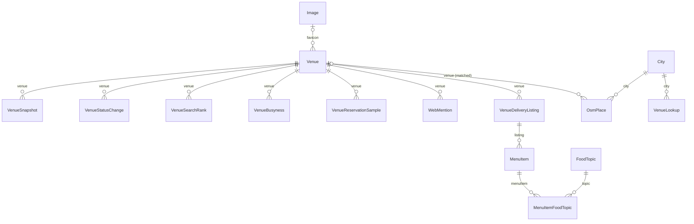
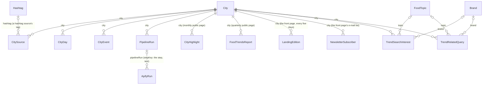
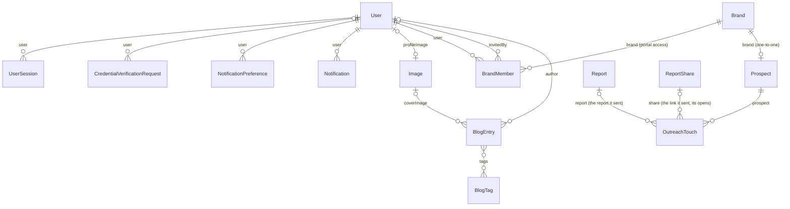

# Entities and how they connect

A snapshot of the MikroORM entities in `apps/backend/src/modules/*/entities/` (60 tables), drawn by area.

- **Solid line**: a foreign key (`@ManyToOne` / `@OneToOne` / `@ManyToMany`).
- **Dotted line**: a soft link. The row only holds text or ids in jsonb, and code resolves it on read. The database doesn't enforce it, and you can't join on it directly.
- Crow's feet: `||` exactly one, `o|` zero or one, `}o` zero or many. Labels are the field names.

## 1. The product core: venues, posts, reviews, reports

```mermaid
erDiagram
    City ||--o{ Venue : "city"
    Brand ||--o{ Venue : "brand (a branch)"
    City ||--o{ SocialPost : "city"
    City ||--o{ SocialAccount : "city (found by)"

    Creator ||--o{ SocialAccount : "creator"
    Brand |o--o{ SocialAccount : "brand (own account)"
    Venue |o--o{ SocialAccount : "branch (own account)"
    Brand |o--o{ SocialAccount : "suggestedBrand"
    SocialAccount ||--o{ SocialAccountSnapshot : "account"
    SocialAccount |o--o{ SocialPost : "account"

    SocialPost ||--o{ Mention : "post"
    SocialPost ||--o{ PostComment : "post"
    SocialPost ||--o{ PostSource : "post (every find)"
    CitySource |o--o{ PostSource : "source (the city source it is)"
    Venue |o--o{ PostSource : "venue (a venue's search or place page)"
    SocialPost ||--o{ PostHashtag : "post"
    Hashtag ||--o{ PostHashtag : "hashtag"
    FoodTopic |o--o{ Hashtag : "foodTopic"
    Brand |o--o{ Hashtag : "brand"
    Brand |o--o{ Mention : "brand (matched)"
    Venue |o--o{ Mention : "venue (matched branch)"

    Venue ||--o{ Review : "venue"

    Review |o--o{ FeedbackPoint : "review"
    Mention |o--o{ FeedbackPoint : "mention"
    City ||--o{ FeedbackPoint : "city"
    FoodTopic |o--o{ FeedbackPoint : "foodTopic (the dish's)"

    Brand ||--o{ Report : "brand"
    City |o--o{ Report : "city (null = all cities)"
    Report ||--o{ ReportShare : "report"
    Brand ||--o{ BrandReportConfig : "brand (one report each, monthly)"
    ReportTemplate |o--o{ BrandReportConfig : "template (copied from; null = custom)"
    BrandReportConfig |o--o{ Report : "config (set null)"
    ReportTemplate |o--o{ Report : "template (set null)"
    User |o--o{ ReportShare : "createdBy"

    Brand ||--o{ BrandCompetitor : "brand"
    Venue |o--o{ BrandCompetitor : "branch"
    Venue |o--o{ BrandCompetitor : "venue (rival place)"
    Brand |o--o{ BrandCompetitor : "rival (rival brand)"

    FoodTopic |o--o{ FoodTopic : "parent"
    Venue ||--o{ VenueFoodTopic : "venue"
    FoodTopic ||--o{ VenueFoodTopic : "topic (admin tag/exclusion, or computed tag)"
    Mention ||--o{ MentionFoodTopic : "mention"
    FoodTopic ||--o{ MentionFoodTopic : "topic (cuisine's, else category's)"

    Mention }o..o| City : "city (text the LLM read)"
    Brand ||--o{ BrandExcludedVenue : "brand"
    Venue ||--o{ BrandExcludedVenue : "venue (not its branch)"
    SocialAccount ||--o{ AccountRejectedBrand : "account"
    Brand ||--o{ AccountRejectedBrand : "brand (not theirs)"

    Mention {
        text venueName
        text cuisine "free text"
        text sentiment
        text summary
    }
    Review {
        text text
        int stars
        text sentiment
    }
    FeedbackPoint {
        text sourceKind "review | mention (exactly one set)"
        text month "YYYY-MM of the source"
        text sentiment "praise positive, complaint negative"
        text topic
        text theme "FEEDBACK_THEMES key"
        text detail "null on a dish-only row"
        text dish
        text dishKey
        float amount "with unit: minutes | money"
    }
    Venue {
        text placeId "Google Maps"
        text category
        jsonb categories
    }
    FoodTopic {
        text key "e.g. burgers"
        text label
        enum kind "cuisine|dish|drink|diet|format|meal"
        jsonb aliases
    }
    Report {
        text month "YYYY-MM"
        jsonb data "ReportData"
        text name "its configuration's at the build"
        jsonb sections "ReportSection embeddables"
    }
    ReportTemplate {
        text name
        boolean isDefault
        jsonb sections "ReportSection embeddables, one class per kind"
    }
    BrandReportConfig {
        text name
        enum status "active|inactive"
        jsonb sections "its own copy"
    }
```

## 2. Data hanging off a venue

## 3. City-level: pipeline, trends, published pages

## 4. Accounts, sales, blog

## Standalone tables (no foreign keys)

| Entity | What it is | Soft links |
|---|---|---|
| `BacklogRun` | One LLM backlog's work on one UTC day (`modules/backlog`) | `key` is an `LlmBacklog.key` |
| `BrandDismissal` | An admin's "not one brand" on a brand suggestion | `key` is a `brandKey` |
| `FoodTopicIgnoredWord` | A cuisine word that maps to no topic ("supermarket") | `key` is a `normalizeCuisine` key |
| `Embedding` | A cached embedding vector for an input string | none |
| `FsmStateChange` | Audit row for the state-machine engine | `ownerType` + `ownerId` (polymorphic; no machine uses it today) |
| `Image` | An uploaded or remote image/video | referenced by `User`, `Venue`, `BlogEntry` |

## Notes

- **Brand vs Venue**: a `Brand` is the business, a `Venue` is one of its branches (a Google Maps place). Reports, outreach, competitors and portal access are per brand. Reviews and most venue data are per branch.
- **Feedback**: what a review or a post's mention says is `FeedbackPoint` rows, one per praise or complaint point (theme, sentiment, the dish it is about, the number it states), one per dish no point names, and one per change a reviewer noticed (`change`: neutral, filed under a theme). Brand and venue are not copied onto them: readers join through the review's venue or the mention's brand and venue, so a re-match or a merge moves the feedback with no row rewritten.
- **Post sources and hashtags**: what found a post is `PostSource` rows, one per source each time one finds it, so yield and what only one source found are counts; a find that is no city source (a venue's search or place page, a source since removed) keeps its kind and value. A caption's hashtags are `PostHashtag` rows to one `Hashtag` per tag across platforms, which names a food topic or a brand when it is one.
- **Food topics**: every "what kind of food is this" is a row with a foreign key to `FoodTopic`: `MentionFoodTopic` (a mention's cuisine's topics, else its venue's category's), `MenuItemFoodTopic`, `VenueFoodTopic` (an admin's tag or exclusion, and the computed tags with their primary), `FeedbackPoint.foodTopic` (a dish's) and the two trends tables. Topics are stored as resolved, without parents (readers add them). The text is matched once, by each row's writer (`FoodTopicIndex` in `modules/food-topics/util/food-topics.ts`), and again for everything by `FoodTopicRelinkJob` whenever a topic or alias changes; only the unrecognised-words list reads raw cuisines and categories.
- **jsonb snapshots**: `Report.data`, `CityHighlight.data`, `FoodTrendsReport.data` and `LandingEdition.data` / `copy` are built documents. They copy names and numbers from the tables above and don't reference them.
