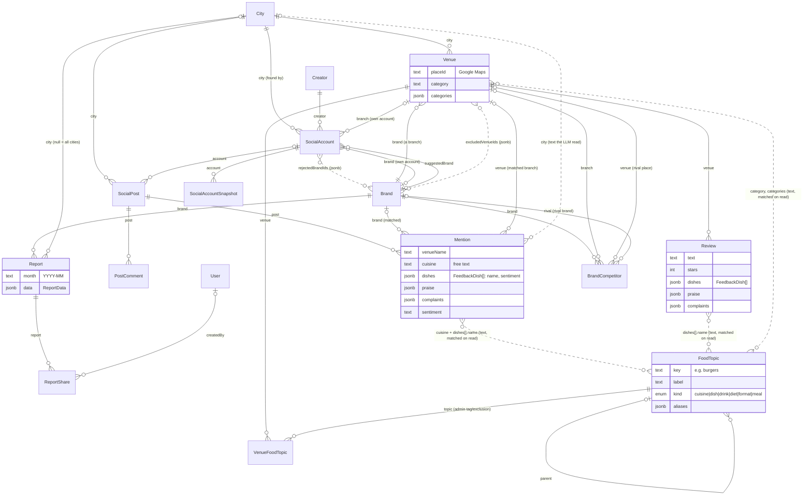
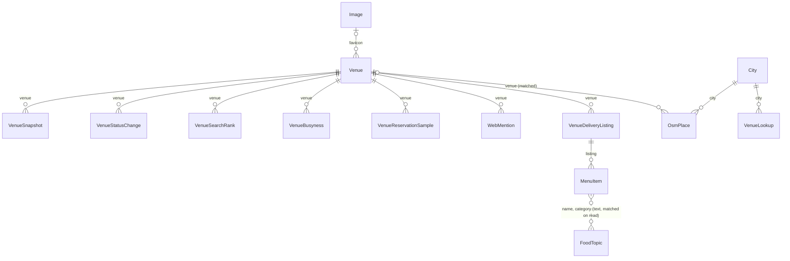
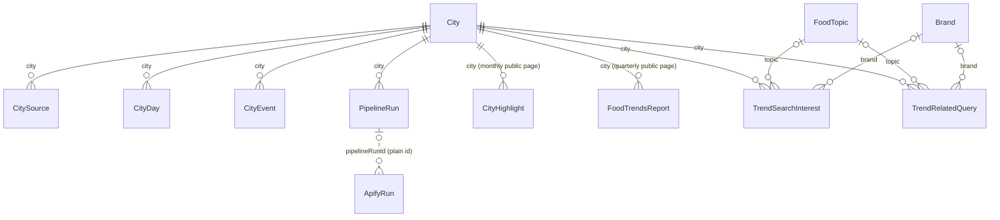
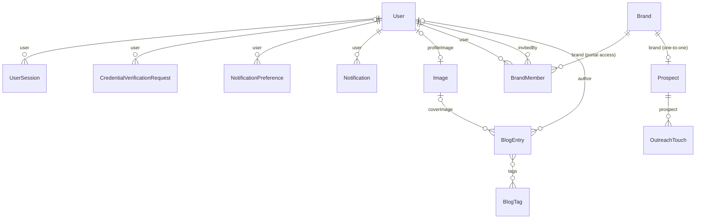

# Entities and how they connect

A snapshot of the MikroORM entities in `apps/backend/src/modules/*/entities/` (50 tables), drawn by area.

- **Solid line**: a foreign key (`@ManyToOne` / `@OneToOne` / `@ManyToMany`).
- **Dotted line**: a soft link. The row only holds text or ids in jsonb, and code resolves it on read. The database doesn't enforce it, and you can't join on it directly.
- Crow's feet: `||` exactly one, `o|` zero or one, `}o` zero or many. Labels are the field names.

## 1. The product core: venues, posts, reviews, reports

## 2. Data hanging off a venue

## 3. City-level: pipeline, trends, published pages

## 4. Accounts, sales, blog

## Standalone tables (no foreign keys)

| Entity | What it is | Soft links |
|---|---|---|
| `ApifyRun` | One paid Apify actor run and its cost | `pipelineRunId`, `stepKey` (plain text) |
| `BrandDismissal` | An admin's "not one brand" on a brand suggestion | `key` is a `brandKey` |
| `FoodTopicIgnoredWord` | A cuisine word that maps to no topic ("supermarket") | `key` is a `normalizeCuisine` key |
| `Embedding` | A cached embedding vector for an input string | none |
| `FsmStateChange` | Audit row for the state-machine engine | `ownerType` + `ownerId` (polymorphic; no machine uses it today) |
| `Image` | An uploaded or remote image/video | referenced by `User`, `Venue`, `BlogEntry` |

## Notes

- **Brand vs Venue**: a `Brand` is the business, a `Venue` is one of its branches (a Google Maps place). Reports, outreach, competitors and portal access are per brand. Reviews and most venue data are per branch.
- **Food topics**: only `VenueFoodTopic` (admin tags) and the two trends tables have a foreign key to `FoodTopic`. Posts, reviews, menus and Google categories reach topics only through text matching at read time (`FoodTopicIndex` in `modules/food-topics/util/food-topics.ts`).
- **jsonb snapshots**: `Report.data`, `CityHighlight.data` and `FoodTrendsReport.data` are built documents. They copy names and numbers from the tables above and don't reference them.
