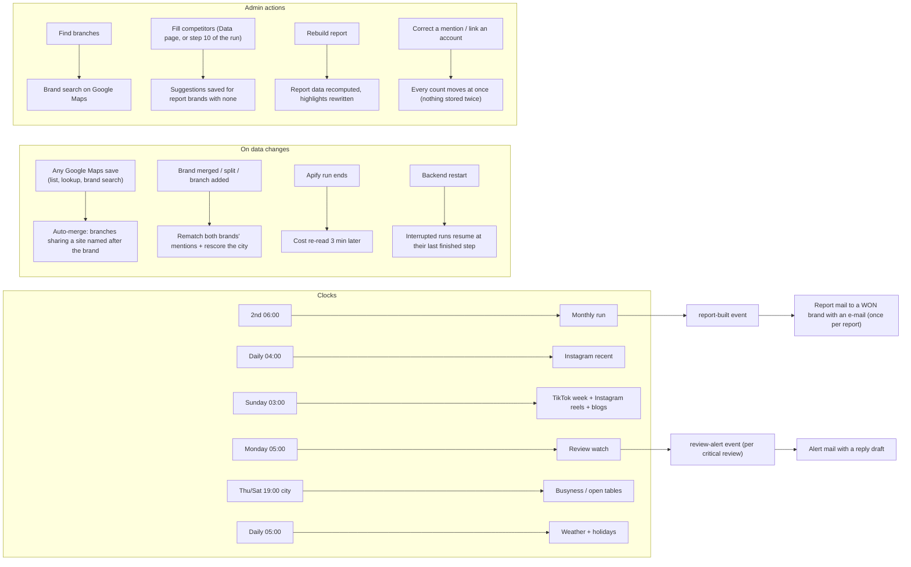

# Timeline and triggers

## The calendar

All clock times are UTC unless marked "city time" (Berlin is UTC+1/+2).

| Cadence | When | What | Scope |
|---|---|---|---|
| Hourly | :00 | Demand check: queues the busyness and reservation samples for any city whose local clock reads 19:00 on a sampling day | Cities with the cron on |
| Hourly | :20 | Venue websites: due venues' websites for up to 20 minutes, one fetch per website, for the icon and the Instagram and TikTok profiles the site links | All open venues |
| Daily | 04:00 | **Instagram, recent posts**: the newest page of each hashtag, kept two days back, then the free extraction and matching of the new posts | Cities with Instagram on |
| Daily | 05:00 | Weather and holidays, last 7 days refreshed | Active cities |
| Daily | 06:30 | **Front page**: for a city whose front page is five days old, the last 30 days counted again (places, dishes, openings, trends), the lines written by the full model (one call) and checked, and the new edition published on munchwerk.com | Cities with the cron on |
| Weekly | Sunday 03:00 | **Weekly listening**: the TikTok searches over the last week and a short page of each TikTok hashtag, the Instagram hashtags' top reels, the new articles of the city's food blogs (free), the week's posts of every watched profile (creators the city follows, report brands' and their competitors' own accounts), then the free extraction and matching, a Google Maps lookup of the names nothing matched (only names not searched lately, cents a week), matching again, and last a lookup of each brand's handle on the platform it has no own account on ($1) | Cities with the cron on (TikTok where it has sources, reels where Instagram is on, blogs where it has some, watched profiles everywhere) |
| Weekly | Monday 05:00 | **Review watch**: subscribers' reviews of the last 10 days, then an alert mail per new critical review | Cities with at least one subscriber |
| Twice weekly | Thu + Sat 19:00 city time | **Busyness sample**: Google popular times of the report brands and competitors | Cities with the cron on |
| Twice weekly | Tue + Fri 04:30 | **Rating snapshots**: today's Google rating and review count of every venue posts named in the last 30 days and every one with 500+ reviews (~3,300 in Berlin, ~$2 a run) | Cities with the cron on |
| Weekly | Thu 19:00 city time | **Open tables**: Friday and Saturday evening slots on every venue with a booking page (subscribers first, 600 max) | Same |
| Monthly | **2nd, 06:00** | **The monthly run** for the month that ended (see below) | Cities with the cron on |
| Quarterly | 2nd, 06:00, when the last one is 3 months old | City-wide Google Maps list, then the brand branch search, queued before that month's run | Same |
| Monthly (with the run) | 2nd, 06:00 | OSM sync (free) and OSM lookups (paid, only never-searched places), queued before the run | Cities with an OSM boundary |

A month in the life of one city:

```
Day 1       Reviews of the last day of the month are still arriving
Day 2 06:00 [quarterly: city list → branch search] → OSM sync → OSM lookups → MONTHLY run
Day 2 ~hrs  21 steps, one after another (money steps capped), reports built, mailed to subscribers
Day 2–31    Daily Instagram pages, each followed by extraction and matching.
            Sunday TikTok week, Instagram reels and blogs, then extraction, matching, name lookups and matching again.
            Thursday/Saturday samples. Monday review watch.
Next 2nd    The run for this month
```

## The monthly run, step by step

One run per city, 22 steps strictly in order, one city at a time, never retried automatically (a retry would pay twice). A step that fails marks the run failed; an admin reruns it from the Data page. "Finish the month" reruns a month and skips the paid steps that already succeeded.

```mermaid
flowchart TD
    A["1 Scrape TikTok · $7<br/>month end: searches + short hashtag pages"] --> B["2 Scrape Instagram · $8<br/>city hashtags: posts + reels"]
    B --> C["3 Extract mentions · LLM<br/>which venues each post names"]
    C --> D["4 Match mentions<br/>mention → venue, author → own account"]
    D --> E["5 Look up venues · $6<br/>Google Maps for unmatched names"]
    E --> F["6 Match again"]
    F --> G["7 Scrape venue posts · $8<br/>TikTok search + Instagram place, per report brand"]
    G --> G2["8 Scrape watched accounts · $4<br/>creators the city follows, report brands' and rivals' own accounts"]
    G2 --> H["9–10 Extract + match again"]
    H --> H2["11 Fill competitors · free<br/>report brands with none get five suggestions"]
    H2 --> I["12 Scrape reviews · $12<br/>every branch + competitors, + TripAdvisor;<br/>six months back for new ones"]
    I --> J["13 Analyse reviews · LLM"]
    J --> K["14 Refresh details · $2<br/>hours, amenities, review tags"]
    K --> L["15 Scrape delivery · $7<br/>Wolt menus, Lieferando listing"]
    L --> N["16 Scrape comments · $13<br/>top 5 TikTok posts per brand"]
    N --> O["17 Analyse comments · LLM"]
    O --> P["18 Scrape press · $3"]
    P --> Q["19 Track search ranks · $4"]
    Q --> R["20 Google Trends · $2"]
    R --> S["21 Build reports · LLM<br/>top 20 brands + every subscriber"]
    S --> T["22 Score leads · free<br/>every brand in the city"]
```



**Who the "report brands" are is decided fresh at each step** from the mentions matched so far: the top 20 by posts from other people, plus every subscriber. Step 7 searches those brands' names, which adds posts about them, so the top list hardens from step 7 on. Brands just outside the top never get their name searched (see the gaps doc).

## The event graph: what triggers what



## What is **not** triggered by anything (today)

- **Lead scores between runs.** Scored once a month at the end of the run.

## Durations and ordering guarantees

- Runs are a queue: oldest first, one at a time, across all cities. A second city's run waits for the first.
- Each step's result is stored as it finishes; a restart resumes a run at the step it was in and re-attaches to the Apify runs it had already started, so nothing is paid twice.
- Apify's Free plan allows 5 concurrent actor jobs and 16 GB; steps that fan out (comments) run 4 side by side and wait when refused.
- A report is mailed only when it is the brand's newest and has not been sent before; a rebuild or a backfilled older month mails nobody.
